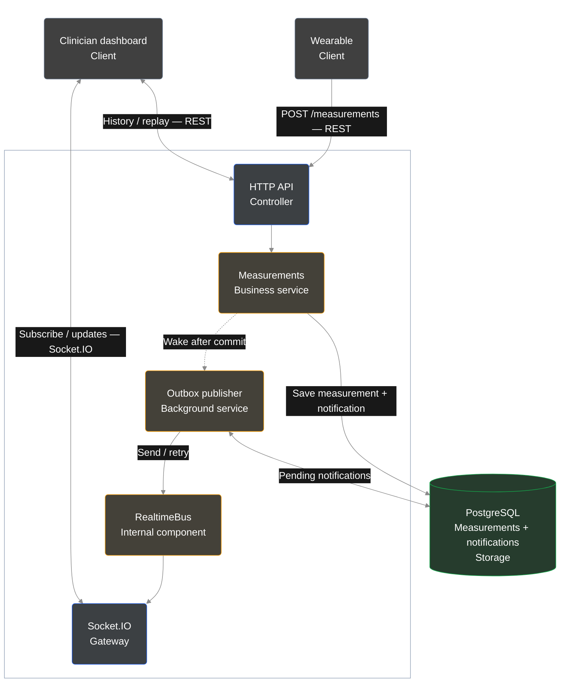

# Biometric Measurements System — Design

## Purpose and Scope

• Accept wearable measurements, store each event once, and provide patient history and live updates to authorized clinicians.  
• One backend wakes its publisher after storage; the publisher sends live updates and retries, while replay supports recovery.

### Design Assumptions

• `userId` identifies the person being measured; credentials define who may read or write that user's measurements.  
• `(userId, eventId)` identifies one event. Keep the same ID and values when retrying.  
• Validate IDs and values as described below; accept delayed measurements and sort history by measurement time.  
• HTTP success confirms durable storage. The receiving client saves its replay checkpoint locally; sending does not prove dashboard processing. Keep the PostgreSQL volume to preserve data across restarts.

## Architecture and Technologies

## 1. Data Validation

• Require valid IDs, timezone-qualified timestamps, integer heart rate **20–250**, and optional nonnegative HRV. These are application assumptions.  
• Return **400** for invalid input, numeric strings, or unknown fields. Accept delayed and future timestamps; no clock-skew filter is applied.  
• Reject precision above milliseconds; store missing/null HRV as null. Input examples and error codes: [README.md](README.md).

## 2. Responsiveness and Concurrent Clients

• Commit storage, wake the publisher, and return success without waiting for delivery. HTTP success does not confirm dashboard receipt.  
• RealtimeBus calls the gateway directly; patient rooms separate subscribers. PostgreSQL stores pending notifications for retry.  
• Unique `(userId, eventId)` prevents duplicate storage, including concurrent retries.  
• **201:** new record. **200:** identical retry, without another notification. **409:** conflicting values; preserve the original.

### Latency and Ordering

• Wake the publisher immediately after commit; polling every 50 ms recovers missed wake-ups. Scheduling and database claims add delivery latency; benchmark actual receipt.  
• Send claimed batches before indexing replay positions. Positions follow committed replay order; live delivery does not promise strict arrival order.

## 3. Throughput and Buffering

### Targets and Limits

• Baseline: **100 measurements/second, 100 dashboards**. Higher capacity and multiple-instance comparisons are optional extensions; use measured results below for current limits.  
• Targets: HTTP p95 **500 ms**; live-update p95 **1 second**. The assignment sets no numeric deadline; these are test assumptions, not hard real-time guarantees.  
• Per backend: **10 database connections**, **3-second** acquisition timeout, **5-second** statement timeout. Growing backlog calls for intake limits and capacity tuning.

### Verified Locally (October 21, 2026)

• One backend, PostgreSQL 16 in Docker, and the generator share a macOS host. These checks do not establish production capacity.  
• **Ingestion only:** 30,000 measurements at **1,000/second** passed; HTTP p95 **64 ms**.  
• **100 receiving clients:** **500 measurements/second** passed; 15,000 stored records and 75,000 updates. HTTP p95 **11 ms**; live-receipt p95 **31 ms**.  
• **Sustained baseline:** 100/second for three minutes passed. In a separate 30-second check with all 100 clients watching one patient, all 300,000 expected updates arrived.  
• **Known limit:** combined 1,000/second stopped early; 914 requests returned 503. All 16,749 accepted records were stored and delivered correctly. HTTP p95 **629 ms**; generator limits were also exceeded.  
• Mixed requests and post-stress recovery passed, without duplicates or wrong-patient updates. Results are from the local benchmark run on October 21, 2026; raw output is excluded from the submission.

### Assignment Scope Decision

• Keep the approved outbox/replay design. Use the checks above for measured capacity.  
• The assignment specifies no numeric throughput target. Further tuning, infrastructure, and multiple-instance testing are separate extensions requiring approval.

### Overload Controls

• Per backend, allow **200 active ingestion requests**. Reject excess work with **503 SERVER_BUSY** and `Retry-After: 1`; do not queue it in memory.  
• Check the pending-notification threshold (**1,000**) every **250 ms**. This sampled threshold can overshoot; it is not a strict queue-size or delivery-time guarantee. Both limits are configurable.  
• Fail closed when storage checks fail. Apply limits to retries too; callers retain the same event ID and values until accepted. The gate does not block history or change permission checks.

### Reliability and Throughput

• Save the measurement and notification atomically. One publisher handles new sends and retries, claiming at most 250 entries per batch and recording successful sends together.  
• Wake-ups contain no measurement data. PostgreSQL holds pending work; polling recovers lost wake-ups and restarts.  
• This removes competing sending paths and reduces publication updates under load. It adds scheduling latency; a crash after sending can still cause duplicates, so clients merge IDs.  
• The single sending path removed overlaps in the tested load run; further capacity changes need review.

## 4. Patient History and Query Performance

• Return the authorized patient's stored heart rate, HRV, and measurement time.  
• Default **20** records; allow **1–100**. A patient/timestamp index supports queries; sort timestamp descending, then ID descending.  
• History latency under ingestion load has not been separately benchmarked; the HTTP results above measure ingestion.

## 5. Persistence, Recovery, and Scaling

### Transactions

• One SQL command saves the measurement and notification in PostgreSQL's implicit transaction. After commit, the publisher claims notifications, sends them, and records each batch in a separate update. A crash before recording success can cause repeated delivery.

### Failures and Delivery Guarantees

• Storage failure prevents publication; temporary failures return sanitized **503** errors. Duplicate identities block migration without deleting data.  
• Publication failure preserves storage success and pending work; the publisher retries with capped backoff. Successful sending does not prove dashboard processing.  
• PostgreSQL preserves data across restarts while its data volume is retained.

### Startup, Shutdown, and Restore

• Fail startup on invalid configuration, unavailable PostgreSQL, or an occupied port; close initialized resources and exit with failure.  
• On shutdown, reject new ingestion, wait up to **10 seconds** for admitted writes, and finish the active publisher batch. Database timeouts still apply; committed pending work remains recoverable after restart.  
• The local backup rehearsal restores measurements, migrations, replay positions, pending notifications, and uniqueness into a temporary database. It verifies recovery mechanics, not a production backup schedule.

### Scaling Considerations

• The implemented architecture uses one backend and PostgreSQL.  
• Future horizontal scaling would require shared live delivery, load balancing, and safe publisher ownership. These require separate design approval and integration tests.  
• Redis is an optional scaling extension; PostgreSQL remains responsible for durable storage and replay.

### Recovery and Duplicate Handling

• PostgreSQL stores measurements; each receiving client separately saves its recent view, deduplication IDs, and checkpoint together. This adds local storage work; external actions need their own idempotency.  
• Live updates arrive through the publisher. Recovery merges by measurement ID and advances its checkpoint only after processing a complete page; older measurements cannot replace the newest reading.  
• Retain completed replay entries for at least **24 hours**, configurable; preserve pending work. Expired checkpoints return **410** for an explicit reset. Longer replay costs more storage.  
• A new listener loads recent history; replay covers measurements accepted after the outbox migration.

## 6. Logging and Monitoring

• Log fixed storage/publication error codes without credentials or biometric payloads. Error meanings: [README.md](README.md).  
• `/health` checks liveness; `/health/ready` checks PostgreSQL and ingestion admission.  
• Production monitoring should track pending notification age, retries, live-receipt latency, and database connection use.

## 7. Security

• Authenticate HTTP and sockets using demo credentials with explicit patient read/write permissions. Authorize writes, history, recovery, and subscriptions.  
• Invalid credential configuration prevents startup; configuration changes require restart.  
• Compatible security patches cleared runtime advisories. The full audit still reports **34 development-tool findings** (29 high, 5 moderate); a major Jest/toolchain upgrade needs separate review.

## 8. Verification

• **Passed:** 246 tests across 15 suites, build, and TypeScript checks. Tests cover validation, retries, concurrent writes, patient isolation, and recovery.  
• **Passed:** clean README setup, migrations, development/compiled startup, simulator/listener flow, and restart with preserved data.  
• **Failure checks passed:** database outage, failed publication, reconnect/replay, overload, shutdown, startup errors, and real backup/restore.  
• Load checks reconcile stored records and patient-specific deliveries; measured results are recorded above.
